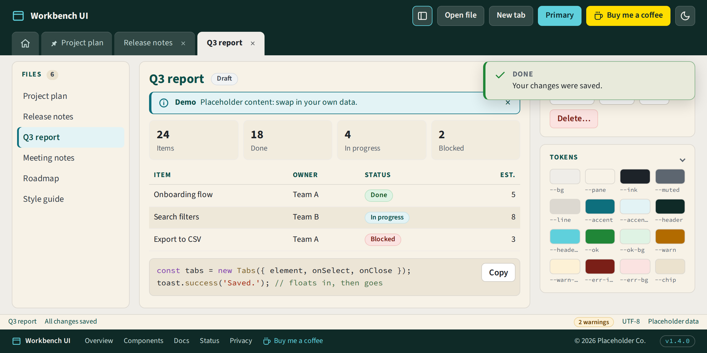
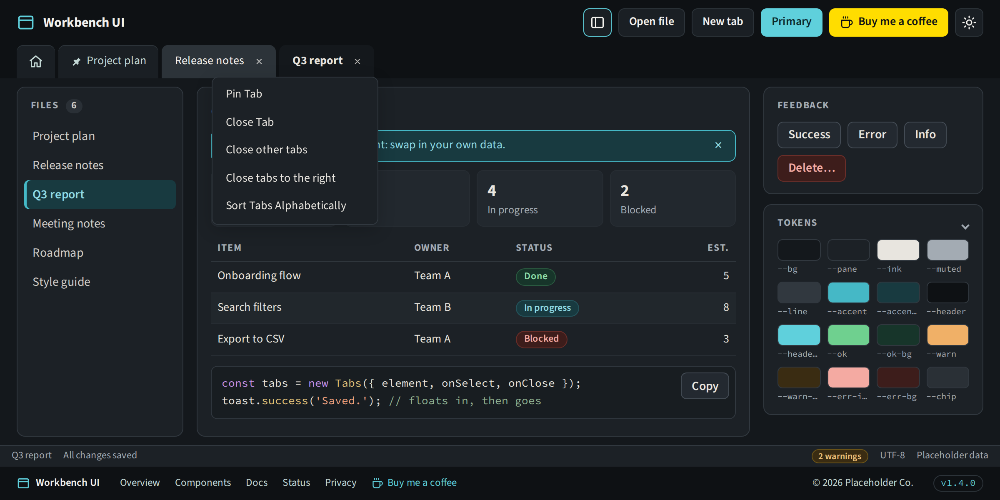

# Workbench UI

[](https://buymeacoffee.com/martynkeigher)

A calm, dense UI kit for tool-style web apps: the kind with a dark header bar, tabs of open documents and panes of detail underneath. Light and dark modes built in.

Plain JavaScript and CSS. No framework and no build step, so it works with any bundler or framework, or with none.





## Install

```bash
npm install github:MartynKeigher/workbench-ui#v0.7.0
```

## Quick start

Pull in the styles once:

```css
@import '@martynkeigher/workbench-ui/fonts.css'; /* optional */
@import '@martynkeigher/workbench-ui/workbench.css';
```

A header bar with tabs:

```html
<header class="wb-header">
  <div class="wb-bar">
    <div class="wb-brand"><span class="wb-brand-name">My tool</span></div>
    <div class="wb-actions">
      <button class="wb-hbtn wb-hbtn-primary" type="button">Export</button>
      <button class="wb-hbtn wb-hbtn-icon" type="button" id="colorMode"></button>
    </div>
  </div>
  <nav class="wb-tabs" aria-label="Open files"></nav>
</header>
```

And the JavaScript to bring it to life:

```js
import { Tabs, ColorMode, applySavedColorMode, toast } from '@martynkeigher/workbench-ui';

applySavedColorMode();
new ColorMode(document.getElementById('colorMode'));

const tabs = new Tabs({
  element: document.querySelector('.wb-tabs'),
  onSelect: (id) => tabs.activate(id),
  onClose: (id) => tabs.close(id),
});
tabs.open('report-1', 'Q3 report');

toast.success('Saved.');
```

## Components

- **App chrome:** footer, header bar, splitter, status bar & tabs.
- **Content:** accordion, avatars and badges, data tables, key–value lists, keyboard keys, panes, selectable lists, status pills, summary tiles & tags.
- **Feedback:** buttons, copy button, empty states, light / dark toggle, loading states, message bars & toasts.
- **Forms:** checkboxes and radios, form layout, search, selects, switches & text inputs.
- **Navigation:** breadcrumbs, in-page tabs, pagination & segmented control.
- **Overlays:** dialogs, drawers, dropdown menus, help and info icons, popovers & tooltips.

To see them all, with markup you can copy, run the demo:

```bash
npm install
npm run dev
```

The demo page has every component in place, and its footer links to the component library (`demo/components/`), which shows each one's variants and code. The JavaScript components list their options at the top of their source files.

## Theming

Every color is a CSS custom property, so override what you like after the kit loads:

```css
:root {
  --accent: #6b3fd1;
}

:root[data-color-mode='dark'] {
  --accent: #a58cff;
}
```

The full list is in [`src/tokens.css`](src/tokens.css).

## Develop

```bash
npm run dev            # demo page with hot reload
npm test               # unit tests
npm run lint           # ESLint
npm run format:check   # Prettier
npm run test:a11y      # accessibility checks (axe)
npm run test:browser   # component tests in a real browser
npm run screenshots    # regenerate the README screenshots
```

Changes are listed in [CHANGELOG.md](CHANGELOG.md).

## Support

Workbench UI is free and MIT licensed. If it saves you time, you can buy me a coffee. It's appreciated, never expected.

[](https://buymeacoffee.com/martynkeigher)

## License

[MIT](LICENSE)
