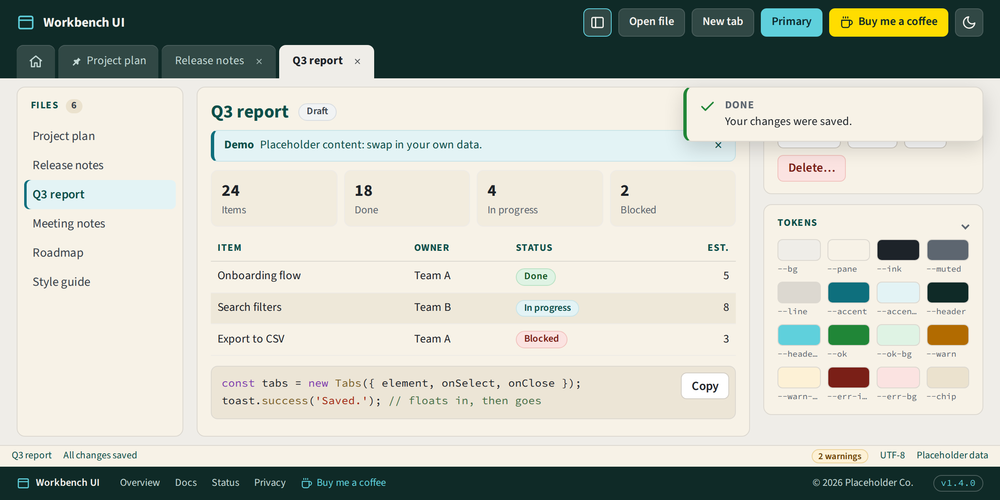
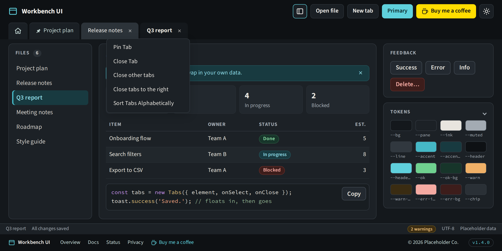
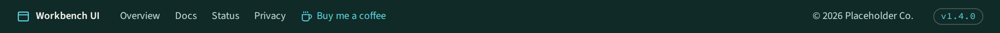
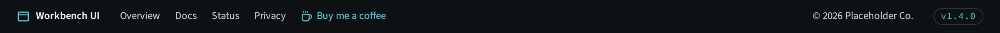
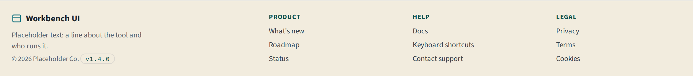
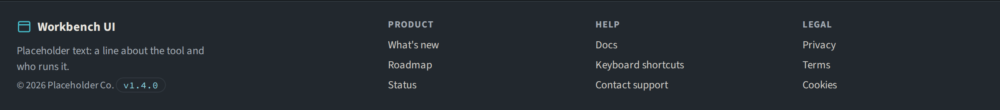

# Workbench UI

[](https://buymeacoffee.com/martynkeigher)

A calm, dense UI kit for tool-style web apps: the kind with a dark header bar, tabs of open
documents and panes of detail underneath.

- **Design tokens** for every colour, font and shadow, with a matching dark palette
- **Header bar**, **tabs** and **toasts**, ready to drop in
- **Panes**, **selectable lists**, **summary tiles**, **data tables** and **status pills** for the
  content underneath
- **Buttons**, **message bars**, a **status bar**, **dialogs** and **copy buttons**
- **Page footers**: a dark bar to match the header, and a columns footer for overview pages
- A **splitter** that resizes and collapses side panes, and remembers how they were left
- **Light / dark toggle** that remembers the choice
- **Plain JavaScript and CSS.** No framework and no build step, so it works with any bundler or
  framework, or with none.





Run `npm run dev` to open the demo page with every component on it. Its footer links to a
second page, an overview with the columns footer. Everything in the screenshots comes from the
demo (`npm run screenshots` makes them, and the [footer](#footer) ones too).

## Install

The package installs straight from this repository's release tags:

```bash
npm install github:MartynKeigher/workbench-ui#v0.5.0
```

In `package.json` that reads:

```json
"dependencies": {
  "@martynkeigher/workbench-ui": "github:MartynKeigher/workbench-ui#v0.5.0"
}
```

`#v0.5.0` pins one release, so every install of your project gets exactly the same kit. See
[Staying up to date](#staying-up-to-date) to have new releases arrive on their own.

## Use

### Styles

Import the whole kit once, from CSS:

```css
@import '@martynkeigher/workbench-ui/fonts.css'; /* optional: Source Sans 3 and Source Code Pro */
@import '@martynkeigher/workbench-ui/workbench.css';
```

Or from JavaScript, with a bundler such as Vite:

```js
import '@martynkeigher/workbench-ui/workbench.css';
```

To take only some parts, import them one by one. `tokens.css` comes first, because the rest uses
it.

| File              | What's in it                                                    |
| ----------------- | --------------------------------------------------------------- |
| `tokens.css`      | Every colour, font and shadow, light and dark                   |
| `base.css`        | Page defaults, the focus ring, `.sr-only`, `.wb-scroll`         |
| `header.css`      | The header bar and its buttons                                  |
| `tabs.css`        | The tab strip and its menu                                      |
| `toast.css`       | Toasts                                                          |
| `pane.css`        | Panes, their headings and counts                                |
| `list.css`        | Selectable lists                                                |
| `tiles.css`       | Summary tiles                                                   |
| `table.css`       | Data tables                                                     |
| `pill.css`        | Status pills                                                    |
| `button.css`      | Buttons under the header bar                                    |
| `message.css`     | Message bars                                                    |
| `statusbar.css`   | The status bar                                                  |
| `footer.css`      | Page footers: the dark bar and the columns footer               |
| `copy-button.css` | The copy button's copied and failed states                      |
| `dialog.css`      | Dialogs                                                         |
| `splitter.css`    | The splitter handle and a collapsed pane                        |
| `fonts.css`       | The two typefaces, from Google Fonts. Without it, system fonts. |

### Header bar

```html
<header class="wb-header">
  <div class="wb-bar">
    <div class="wb-brand">
      <svg class="wb-brand-mark" width="22" height="22">…</svg>
      <span class="wb-brand-name">My tool</span>
    </div>
    <div class="wb-actions">
      <input class="wb-file-input" id="open" type="file" />
      <label class="wb-hbtn" for="open">Open file</label>
      <button class="wb-hbtn wb-hbtn-primary" type="button">Export</button>
      <button class="wb-hbtn wb-hbtn-icon" type="button" id="colorMode"></button>
    </div>
  </div>
  <nav class="wb-tabs" aria-label="Open files"></nav>
</header>
```

### Toasts

```js
import { toast } from '@martynkeigher/workbench-ui';

toast.success('Saved.');
toast.error('That file could not be read.', { duration: 6000 });
toast.info('Three rows were skipped.', { title: 'Heads up' });
toast.show('Report saved as PDF.', { type: 'success', title: 'Exported' });
```

| Option     | Default                                  |                                  |
| ---------- | ---------------------------------------- | -------------------------------- |
| `type`     | `'success'`                              | `'success'`, `'error'`, `'info'` |
| `title`    | `Done` / `Something went wrong` / `Note` | Heading over the message         |
| `duration` | `3000`                                   | Milliseconds on screen           |

Messages and titles are set as text, never as HTML, so anything can be passed in. Toasts stack
in the top-right corner. Set `--wb-toast-top` to move them below a header:

```css
:root {
  --wb-toast-top: 104px;
}
```

For more than one stack, or other default titles, make your own `new Toaster({ container, titles })`.

### Tabs

```js
import { Tabs } from '@martynkeigher/workbench-ui';

const tabs = new Tabs({
  element: document.querySelector('.wb-tabs'),
  onSelect: (id) => {
    tabs.activate(id);
    show(id);
  },
  onClose: (id) => show(tabs.close(id)), // close() returns the tab to show next
  onHome: () => {
    tabs.activate(null);
    showHome();
  },
  homeTitle: 'Overview',
});

tabs.setHome(true); // optional Home tab, always first
tabs.open('report-1', 'Q3 report');
```

People can pin tabs, drag them into a different order, move them with Ctrl+Shift+← / →, and
right-click (or press Shift+F10) for a menu that pins, closes, closes the others, closes those to
the right, or sorts A to Z. The strip keeps no content: your `onSelect` decides what each id
shows.

| Method                 |                                                       |
| ---------------------- | ----------------------------------------------------- |
| `open(id, title)`      | Add a tab, or retitle an open one, and make it active |
| `close(id)`            | Remove a tab. Returns the id to show next, or `null`  |
| `activate(id \| null)` | Make a tab active (`null`: Home)                      |
| `setHome(show)`        | Show or hide the Home tab                             |
| `has(id)`              | Whether a tab is open                                 |
| `togglePin(id)`        | Pin or unpin                                          |
| `sortUnpinned()`       | Sort unpinned tabs A to Z                             |
| `destroy()`            | Remove the menu and every listener                    |

### Light and dark

```js
import { ColorMode, applySavedColorMode } from '@martynkeigher/workbench-ui';

applySavedColorMode(); // as early as you can, so a dark page never flashes light
new ColorMode(document.getElementById('colorMode'), {
  onChange: (mode) => console.log(mode), // 'light' or 'dark'
});
```

It sets `data-color-mode="light"` or `"dark"` on `<html>` and keeps the choice in
`localStorage` (key `colorMode`; pass `storageKey` to change it). An empty button gets moon and
sun icons. A button with its own `.wb-icon-moon` and `.wb-icon-sun` elements keeps them.

### Panes

A bordered card for each area of the screen, with small uppercase headings. A `.wb-count` sits
in a heading. A second heading in the same pane starts a new group, with space above it.

```html
<section class="wb-pane">
  <h2 class="wb-pane-head">Files <span class="wb-count">6</span></h2>
  …
  <h2 class="wb-pane-head">Recent</h2>
  …
</section>
```

### Selectable lists

Items to pick from, such as files. Each item is a `<button>` (or an `<a>`), so it takes keyboard
focus. Mark the one showing with `aria-current="true"`, or use `aria-selected="true"` in a
listbox. In a pane, the items line up with the pane's heading.

```html
<ul class="wb-list">
  <li><button type="button" class="wb-list-item">Project plan</button></li>
  <li><button type="button" class="wb-list-item" aria-current="true">Q3 report</button></li>
</ul>
```

Add `.wb-scroll` to a long list in a fixed-height pane. Changing the selection is up to you:
move `aria-current` to the item that was picked.

### Summary tiles

A row of numbers, each with a label. As many tiles fit on a row as there is room for, at least
120px each.

```html
<div class="wb-tiles">
  <div class="wb-tile">
    <span class="wb-tile-value">24</span>
    <span class="wb-tile-label">Items</span>
  </div>
  <div class="wb-tile">
    <span class="wb-tile-value">2</span>
    <span class="wb-tile-label">Blocked</span>
  </div>
</div>
```

### Data tables

Full width, with small uppercase column headings and striped rows. `.wb-num` right-aligns a
column of numbers, with every digit the same width so they line up.

```html
<table class="wb-table">
  <thead>
    <tr>
      <th>Item</th>
      <th>Status</th>
      <th class="wb-num">Est.</th>
    </tr>
  </thead>
  <tbody>
    <tr>
      <td>Search filters</td>
      <td><span class="wb-pill wb-pill-accent">In progress</span></td>
      <td class="wb-num">8</td>
    </tr>
  </tbody>
</table>
```

### Status pills

A short status word. A plain `.wb-pill` is neutral.

```html
<span class="wb-pill wb-pill-ok">Done</span>
<span class="wb-pill wb-pill-warn">Needs owner</span>
<span class="wb-pill wb-pill-accent">In progress</span>
<span class="wb-pill wb-pill-err">Blocked</span>
<span class="wb-pill">Not started</span>
```

### Buttons

For the page under the header bar (the header bar has `.wb-hbtn`). `-primary` is the one main
action in a place; `-danger` deletes or discards. `.wb-btn-row` lines several up.

```html
<div class="wb-btn-row">
  <button type="button" class="wb-btn">Cancel</button>
  <button type="button" class="wb-btn wb-btn-primary">Save</button>
  <button type="button" class="wb-btn wb-btn-danger">Delete</button>
</div>
```

### Message bars

A note inside the content that stays until it no longer applies (a toast goes by itself). Kinds:
`-info` (the default look), `-ok`, `-warn` and `-err`. Give it `role="status"`, or
`role="alert"` for an error that needs action now. The close button is optional; removing the
message is up to you.

```html
<div class="wb-message wb-message-warn" role="status">
  <div class="wb-message-body">
    <strong class="wb-message-title">Read only</strong>
    Someone else has this file open.
  </div>
  <button type="button" class="wb-message-close" aria-label="Dismiss">×</button>
</div>
```

### Status bar

A thin bar along the bottom of the app. Items are text, or buttons when clicking one does
something. `.wb-statusbar-end` pushes an item, and those after it, to the right. Put
`role="status"` on an item whose text changes, so screen readers hear it. Where the bar sits (a
grid row, `position: sticky`) is up to your layout.

A page has one `<footer>`. If yours also has a [page footer](#footer), make the status bar
a named region instead: `<section class="wb-statusbar" aria-label="Status">`.

```html
<footer class="wb-statusbar">
  <span class="wb-statusbar-item">Q3 report</span>
  <span class="wb-statusbar-item" role="status">All changes saved</span>
  <button type="button" class="wb-statusbar-item wb-statusbar-end">
    <span class="wb-pill wb-pill-warn">2 warnings</span>
  </button>
  <span class="wb-statusbar-item">UTF-8</span>
</footer>
```

### Dialogs

`confirmDialog()` asks a yes / no question and resolves `true` or `false`. Cancel, the × and
Escape all mean no. With `danger: true` the yes button is a danger button and the focus starts
on Cancel.

```js
import { confirmDialog } from '@martynkeigher/workbench-ui';

const yes = await confirmDialog({
  title: 'Delete Q3 report?',
  message: "It goes for everyone with access. This can't be undone.",
  confirmLabel: 'Delete', // default 'OK'
  cancelLabel: 'Keep it', // default 'Cancel'
  danger: true,
});
```

For anything else, style a native `<dialog>` and open it with `showModal()`. The browser keeps
the focus inside, closes it on Escape and puts the focus back afterwards. A `<form
method="dialog">` closes it from any button, with the button's `value` as `returnValue`.

```html
<dialog class="wb-dialog" aria-labelledby="exportTitle">
  <form method="dialog">
    <div class="wb-dialog-head">
      <h2 class="wb-dialog-title" id="exportTitle">Export</h2>
      <button class="wb-dialog-close" value="cancel" aria-label="Close">×</button>
    </div>
    <div class="wb-dialog-body">…</div>
    <div class="wb-dialog-actions">
      <button class="wb-btn" value="cancel">Cancel</button>
      <button class="wb-btn wb-btn-primary" value="export">Export</button>
    </div>
  </form>
</dialog>
```

Titles and messages are set as text, never as HTML.

### Copy button

```js
import { CopyButton } from '@martynkeigher/workbench-ui';

new CopyButton(document.getElementById('copy'), {
  getText: () => editor.value, // or text: 'a fixed string'
});
```

After a click the button reads "Copied" (or "Couldn't copy") for a moment, and screen readers
hear the same. A button with an icon keeps it: put the words in a `.wb-copy-label` element and
only that changes. The clipboard needs a secure page (`https://` or `localhost`); elsewhere it
fails, and says so.

| Option        | Default           |                               |
| ------------- | ----------------- | ----------------------------- |
| `text`        |                   | The text to copy              |
| `getText`     |                   | Or a function that returns it |
| `copiedLabel` | `'Copied'`        | Shown after copying           |
| `failedLabel` | `"Couldn't copy"` | Shown when it failed          |
| `duration`    | `1500`            | Milliseconds either one shows |
| `onCopy`      |                   | Called with the text          |
| `onError`     |                   | Called with the error         |

### Splitter

A handle between two panes that resizes one of them. People drag it, or focus it and use the
arrow keys (Shift for bigger steps), Home and End. Enter or a double-click collapses the pane out
of the way; clicking or dragging the handle brings it back. Size and collapsed state are
remembered with `storageKey`.

It writes the size to a CSS custom property on the layout element, so your layout decides how to
use it:

```html
<main class="layout">
  <aside class="wb-pane" id="files">…</aside>
  <div class="wb-splitter" aria-label="Files pane width"></div>
  <section class="wb-pane">…</section>
</main>
```

```css
.layout {
  display: grid;
  grid-template-columns: var(--wb-split, 240px) 8px minmax(0, 1fr);
}
```

```js
import { Splitter } from '@martynkeigher/workbench-ui';

const splitter = new Splitter(document.querySelector('.wb-splitter'), {
  target: document.getElementById('files'),
  min: 160,
  max: 480,
  storageKey: 'filesWidth',
  toggles: [document.getElementById('toggleFiles')], // optional buttons elsewhere
});
```

| Option        | Default               |                                                     |
| ------------- | --------------------- | --------------------------------------------------- |
| `target`      |                       | The pane it sizes, before or after the handle       |
| `container`   | the handle's parent   | Where the custom property goes                      |
| `property`    | `'--wb-split'`        | The custom property                                 |
| `orientation` | `'vertical'`          | `'horizontal'` for a handle between stacked panes   |
| `min`, `max`  | `120`, `600`          | In px                                               |
| `size`        | the target's size now | Starting size, when nothing is saved                |
| `step`        | `16`                  | Arrow key step in px (×4 with Shift)                |
| `collapsible` | `true`                | Whether Enter, a double-click or a toggle collapses |
| `storageKey`  | not remembered        | Remember size and collapsed state under this key    |
| `toggles`     | `[]`                  | Buttons that collapse it or bring it back           |
| `onResize`    |                       | Called with the size and whether it's collapsed     |

A collapsed pane is sized 0, hidden, and inert, so the keyboard and screen readers skip it too.
Toggle buttons get `aria-expanded`. Methods: `setSize(px)`, `collapse()`, `expand()`,
`toggle()`, `destroy()`.

### Folding panes

`PaneToggle` folds a pane down to its headings, for a pane that stays where it is (a splitter
collapses one sideways). Put the button last in the heading; it draws its own chevron.

```html
<section class="wb-pane" id="details">
  <h2 class="wb-pane-head">
    Details
    <button type="button" class="wb-pane-toggle" aria-label="Details"></button>
  </h2>
  …
</section>
```

```js
import { PaneToggle } from '@martynkeigher/workbench-ui';

new PaneToggle(document.querySelector('#details .wb-pane-toggle'), {
  pane: document.getElementById('details'),
  storageKey: 'detailsFolded', // optional
});
```

## Footer

Two page footers, from `footer.css` (included in `workbench.css`, or on its own as
`@martynkeigher/workbench-ui/footer.css`). Use one per page: a page has one `<footer>`, so if it
also has a [status bar](#status-bar), make that a named region instead.

Each `<nav>` needs a name: `aria-label` on the bar's, its heading on each group. The brand's
icon is yours; mark it `aria-hidden="true"`.

### Bar

`.wb-footer` is dark in both modes, to match the header bar, and sits at the bottom of the
window: brand, links, then anything from `.wb-footer-end` on at the right. The demo page has one.





```html
<footer class="wb-footer">
  <span class="wb-footer-brand"><svg>…</svg> My tool</span>
  <nav class="wb-footer-links" aria-label="Footer">
    <a href="/docs">Docs</a>
    <a href="/status">Status</a>
    <a href="/privacy">Privacy</a>
  </nav>
  <span class="wb-footer-end">© 2026 Example Ltd</span>
  <span class="wb-footer-version">v1.4.0</span>
</footer>
```

In a full-height layout, give it the last grid row (`grid-template-rows: auto 1fr auto`). It
wraps onto two lines on a narrow screen.

### Columns

`.wb-footer.wb-footer-columns` is light and taller, for the end of an overview or home page that
scrolls: an about block, then groups of links, each with a heading. The groups wrap onto more
rows when there isn't room, and every link is at least 24px tall to tap. The demo's overview
page has one.





```html
<footer class="wb-footer wb-footer-columns">
  <div class="wb-footer-about">
    <span class="wb-footer-brand"><svg>…</svg> My tool</span>
    <p>What it is and who runs it.</p>
    <p class="wb-footer-note">© 2026 Example Ltd <span class="wb-footer-version">v1.4.0</span></p>
  </div>
  <nav class="wb-footer-group" aria-labelledby="footHelp">
    <h2 class="wb-footer-group-head" id="footHelp">Help</h2>
    <a href="/docs">Docs</a>
    <a href="/support">Contact support</a>
  </nav>
  <nav class="wb-footer-group" aria-labelledby="footLegal">
    <h2 class="wb-footer-group-head" id="footLegal">Legal</h2>
    <a href="/privacy">Privacy</a>
    <a href="/terms">Terms</a>
  </nav>
</footer>
```

## Theming

Every colour is a custom property. Override any of them after the kit loads, for one palette or
both:

```css
:root {
  --accent: #6b3fd1;
  --accent-ink: #4f2aa6;
  --header-accent: #b49cff;
}

:root[data-color-mode='dark'] {
  --accent: #a58cff;
}
```

The full list, with the role of each one, is in [`src/tokens.css`](src/tokens.css). Your own
styles can use the same tokens (`var(--pane)`, `var(--line)`, `var(--muted)`…), so new screens
match the kit without copying any values.

## Staying up to date

Releases are tagged `vX.Y.Z` and follow [semantic versioning](https://semver.org/). See
[CHANGELOG.md](CHANGELOG.md).

- **Patch and minor** releases (fixes, new components, new options) never need changes on your
  side.
- **Major** releases rename or remove something. The changelog says what to change.

To have new releases arrive without lifting a finger, turn on
[Renovate](https://github.com/apps/renovate) for your project and add this `renovate.json`:

```json
{
  "$schema": "https://docs.renovatebot.com/renovate-schema.json",
  "extends": ["config:recommended"],
  "packageRules": [
    {
      "matchDepNames": ["@martynkeigher/workbench-ui"],
      "matchUpdateTypes": ["minor", "patch"],
      "automerge": true,
      "minimumReleaseAge": null,
      "schedule": ["at any time"]
    }
  ]
}
```

Renovate watches this repository's tags. Each new patch or minor release opens a pull request
in your project that moves the pinned tag (`#v0.5.0` → `#v0.5.1`). Once your checks pass, it
merges itself. Major releases still open a pull request but wait for you, since they may
need changes. (This needs branch protection with required status checks, so a failing build
blocks the merge.)

## Develop

```bash
npm install
```

```bash
npm run dev
```

```bash
npm test
```

`npm run lint` and `npm run format:check` run in CI with the tests.

### Visual tests

```bash
npm run test:visual
```

Playwright takes screenshots of the demo page (light, dark, a toast and a dialog in light, the
tab menu and a collapsed pane in dark, 1200×600 at 2x) and of the whole overview page (light
and dark), and compares them with the images in `visual/demo.spec.js-snapshots/`. Any visual
change fails CI, and the run's `visual-diffs` artifact holds the expected, actual and diff
images. The page loads its fonts from local copies and its timers are paused, so nothing
depends on the network or timing.

Text renders a little differently on each OS, so the committed images come from the Playwright
Linux image CI runs in. When a pull request changes how something looks on purpose, update the
images from GitHub: **Actions → Update screenshots → Run workflow** on the pull request's
branch. It regenerates them, commits any that changed and re-runs CI. Then check the new images
in the pull request's diff. To do the same locally, run this (with Docker):

```bash
docker run --rm -v "$PWD":/work -w /work mcr.microsoft.com/playwright:v1.63.0-noble bash -c 'npm ci && npm run test:visual:update && npm run screenshots'
```

`npm run screenshots` regenerates the README's `docs/screenshot-light.png` and
`docs/screenshot-dark.png` from the same page and states.

### Accessibility tests

```bash
npm run test:a11y
```

[axe-core](https://github.com/dequelabs/axe-core) checks the demo pages in light and dark: the
workbench with nothing open, a toast, the tab menu, a dialog and a collapsed pane, and the
overview page. Any WCAG 2.2 A or AA failure, or any axe best-practice failure, fails CI. That includes the contrast of the page's text in both
palettes. The one exception is listed in `visual/a11y.spec.js` with its reason: the open
tab menu sits outside the page's landmarks, as a context menu does, and takes the focus when it
opens.

axe can't check everything. Keyboard use, focus order and how a screen reader announces things
still need a person, and the unit tests cover the components' keyboard handling.

### Browser tests

```bash
npm run test:browser
```

What jsdom can't do, on the demo page in Chromium: the dialog's focus handling, dragging the
splitter, the clipboard, and what's remembered across a reload.

### Releasing

1. Bump `version` in `package.json`: patch for fixes, minor for anything new, major for anything
   renamed or removed.
2. Add a section for it at the top of `CHANGELOG.md`.
3. Merge to `main`. The release workflow tags `vX.Y.Z` and makes a GitHub release from the
   changelog section.

## Support

Workbench UI is free and MIT licensed. If it saves you time, you can buy me a coffee. It's
appreciated, never expected.

[](https://buymeacoffee.com/martynkeigher)

## Licence

[MIT](LICENSE)
